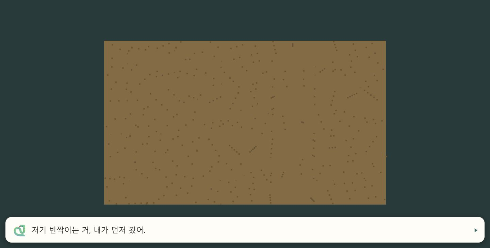
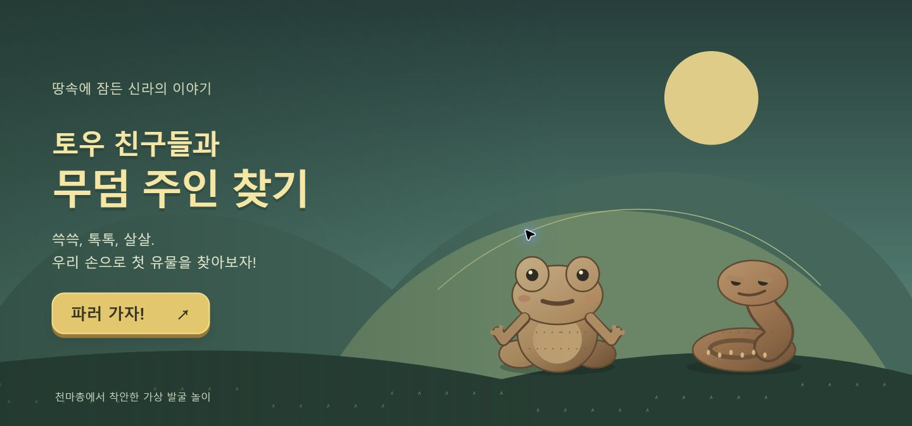
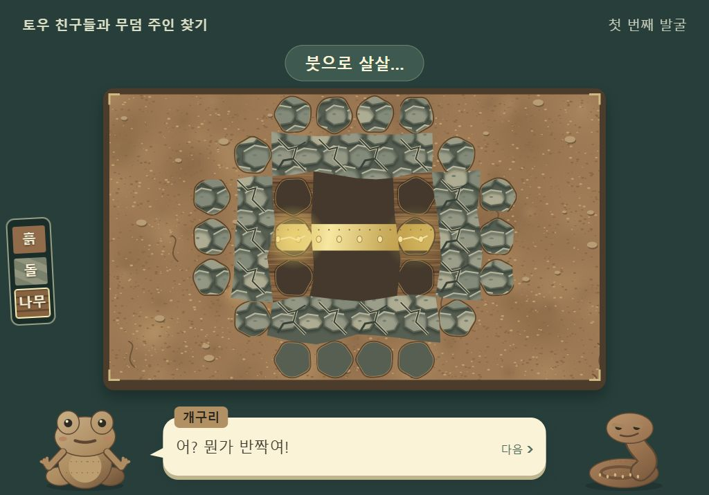
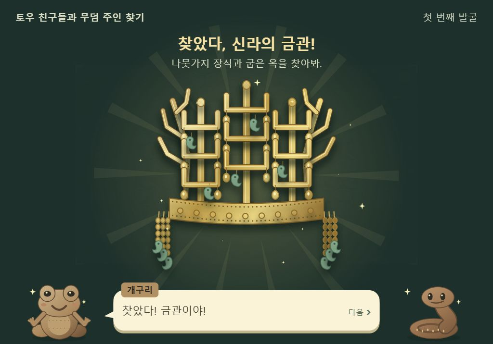
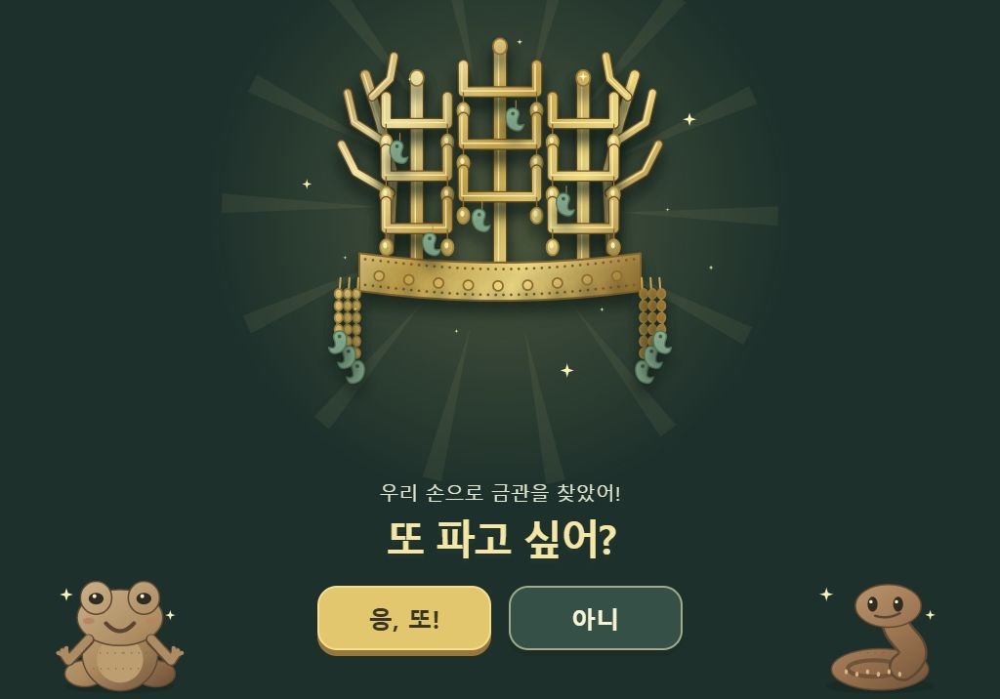

# 초등판 시제품 진단과 비주얼 개선

2026-10-19 / `design/visual-v1`

## 진단

기존 발굴 로직과 입력 테스트 33개는 모두 통과했다. 반면 화면은 단색 재질, 이모지 캐릭터, 비율이 늘어난 임시 금관으로 구성되어 행동의 결과와 발견의 성취가 약했다. 개선의 우선순위는 새로운 게임 규칙보다 눈에 보이는 발굴 과정과 발견 장면이다.

0차 시제품은 손맛 검증용이다. 제목의 ‘무덤 주인 찾기’를 완성하려면 향후 유물 관찰 → 옛사람의 삶 추론 → 자기 말로 설명하는 활동이 필요하다. 이번 변경은 그 범위를 미리 만들지 않는다.

## 변경 전후

변경 전 실제 시작 대사 화면:

변경 후 시작 화면:

변경 후 부분 발굴 — 레이어 비교를 위한 고정 검토 상태:

변경 후 발견·마무리 — 실제 렌더러와 HTML/CSS의 검토 장면:

## 검증

- Node 24.15.0, `npm test`: 33/33 통과.
- 보호된 모델·입력·격자·대사 큐·HUD 파일 및 기존 테스트: diff 없음.
- `/prototype/` 하위 경로에서 로딩 및 전체 흐름 확인. 외부 이미지·폰트·패키지 요청 없음.
- 실제 PointerEvent 입력으로 흙 → 돌 → 나무 → 금관 → 만담 → 다시 하기 진행. 발견 연출 중 탭 보호, 다시 시작, 선택과 발굴 시간 기록까지 12개 확인 통과.
- DPR 2(브라우저 검증 프레임에서 설정), 1024×768 및 1024×600 배치 확인. 브라우저 콘솔 error/warn 없음.
- 매 프레임 한 흙 셀의 마스크를 갱신하는 180회 렌더링: CPU 명령 제출 평균 0.81ms / p95 1.40ms. [측정값](performance.json). GPU 표시 시간이나 실기기 FPS 측정이 아니다.
- 독립 정적 코드 검토: 대상 범위에서 추가 수정이 필요한 문제 없음. 마지막 둥근 마스크 수정은 브라우저에서 별도 재확인.

## 결정과 남은 검증

- 손맛 수치와 6칸 유물 배치는 유지했다. 발굴 중 금띠가 보이고, 발견하면 전체 금관이 등장한다.
- 캐릭터는 특정 출토품을 복제하지 않은 창작 토우 시안이며, 금관은 실측 복원도가 아닌 교육용 직접 제작 도판이다.
- 실제 태블릿의 연속 플레이 성능, 어린이 3~5명의 재도전 반응은 아직 확인하지 않았다.
- 이 브랜치를 공개 Pages 운영 브랜치에 병합하지 않았다. 공개 주소에서 변경 버전의 전체 플레이는 병합 후 확인해야 한다.
- 작은 휴대폰은 현재 검증 범위 밖이다. 1024×600 이상 가로 태블릿·PC를 권장한다.

다음으로는 아이가 설명 없이 ‘문지르기 → 두드리기 → 살살 쓸기’를 이해하는지, 금빛을 따라 찾아가는지, 끝나고 자발적으로 ‘응, 또!’를 누르는지 관찰한다.
