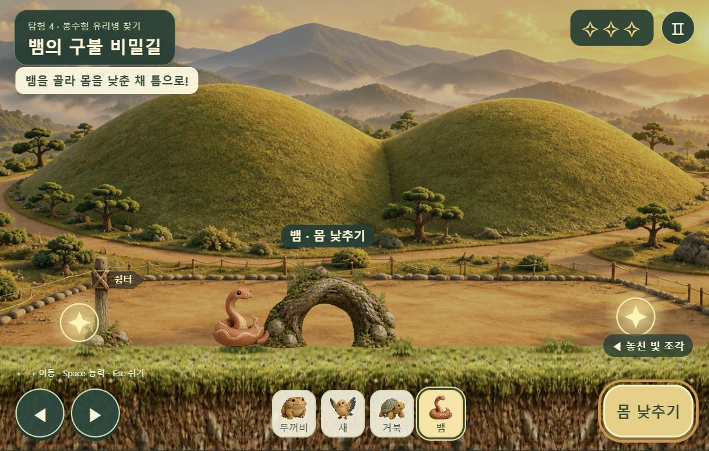
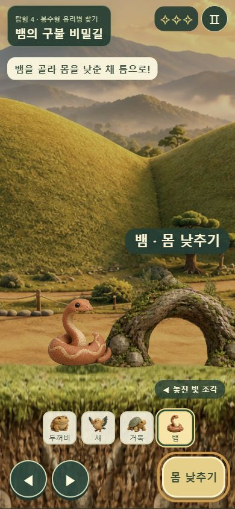

# 탐험길 소품 개선 · 2026-10-22

사용자가 보낸 뱀 구간의 네모 장애물·삼각 깃발·톱니 잔디를 기존 점토 토우/고분 풍경과 같은 재질로 교체했다.

- 힉스필드 `gpt_image_2_5`, low, 1k, 3:2 이미지 **1장만** 생성. 사전 견적 **0.25크레딧**. 완료 작업 `27bba345-3fb0-4e8d-8655-16117edcd5b7`.
- 소품 6개: 이끼와 흙 단면 발판, 목재 방향 표지, 뿌리 터널, 흙더미, 바위, 발굴 도구 바구니와 현장 표지.
- 투명 배경 요청에 불투명 결과가 반환돼 재생성하지 않고 직접 추적한 Canvas 윤곽으로 분리했다. 원본과 생성 프롬프트/출처는 assets/higgsfield/adventure-props-*에 보존.
- 발판 양 끝은 형태를 유지하고 가운데 흙 질감은 반복해서 긴 발판에서도 이미지가 늘어나지 않게 했다. 발판 표면을 기존 착지 높이에 맞췄다.
- 뱀은 실제 구멍으로 지나가며 가까이 있을 때 뿌리의 앞쪽이 토우를 가린다. 통과 뒤 큰 상태 팻말은 없앴다. 쉼터 표지도 장애물 바로 옆에서는 숨긴다.
- 바위 장애물은 정지, 굴러오는 돌만 회전. 발굴 현장의 점선 상자를 도구 소품으로 교체하고 도착 표식 중첩을 줄였다.
- 모바일 ‘몸 낮추기’ 글자가 두 줄로 찢어지는 문제도 수정했다.
- 이동/충돌/발굴 모델, 저장, 음성, BGM, 보호 대상 파일은 수정하지 않았다.

검증: 기존 65개 + 탐험/저장 12개 통과, 실제 main/view DOM 통합 검사 통과, 구문 검사·diff 검사 통과. Chrome에서 터널·바위·흙더미·발굴 현장 확인, 1100×700/390×844/844×390 배치 확인. 검증 페이지의 이동+능력 Pointer Events로 터널 통과 성공, 콘솔 오류 없음. 실기기 터치 검사는 아님.

검증 페이지: 프로젝트 루트 서버의 `checks/adventure-art.html`. 장면 배치는 테스트 페이지에만 있으며 배포 게임에는 건너뛰기 기능을 넣지 않았다.

