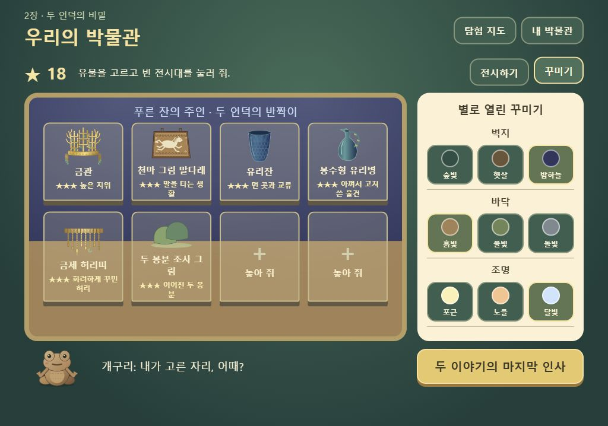

# 놀이 중심으로 재구성 — 2026-10-20

사용자 진단: 교육적이지만 너무 어렵고 재미가 없으며, 스토리가 짧고 원래 계획과 맞지 않는다.

## 원인과 바꾼 점

직전 버전은 ‘무엇을 배웠는지’에 답하려고 관찰 2회, 근거 연결, 새 사례 판단을 필수 진행으로 늘렸다. 이는 원안 v3.0이 버린 ‘학습 활동을 게임처럼 포장하기’로 되돌아간 구현이었다. 설명·검사 대신 손으로 하는 행동과 캐릭터 반응을 진행의 중심에 다시 놓았다.

| 원안의 경험 | 이번 구현 |
|---|---|
| 손맛 발굴 | 기존 입력 그대로, 거북의 돌 깨기·새의 위치 표시 추가 |
| 짧은 그림 선택 | 유물마다 2개, 틀리면 소품 애니메이션과 한 줄 만담, 두 번 틀리면 그림 힌트 |
| 주인 꾸미기 | 세 기억 스티커, 튀어나가는 현대 소품 6종, 별명 3개 중 선택 |
| 내 박물관 | 8개 전시대에 6개 자료 배치, 설명 스티커로 별 획득, 벽·바닥·조명 실제 변경 |
| 이어지는 이야기 | 첫 무덤의 기억 → 전시 → 새 동료 초대 → 둘째 무덤 → 두 봉분 조사 → 전시 확장과 결말 |
| 다시 파고 싶다 | 지도에서 완료한 무덤의 유물을 골라 재발굴; 전시는 보존 |

그림 선택은 핵심 특징을 짚는 짧은 단계다. 별은 오답 횟수와 무관하고 전시 배치·설명 스티커에서만 쌓인다. 보고서나 학습 평가표는 기본 놀이에 넣지 않았다.

## 두 이야기의 범위

- 천마총에서 착안: 금관, 천마 그림 말다래, 유리잔. 높은 지위·말을 타는 생활·먼 곳과 교류를 기억 스티커로 모은다.
- 황남대총에서 착안: 봉수형 유리병, 금제 허리띠, 두 봉분 조사 그림. 수리 흔적·허리 장식·맞붙은 두 봉분을 살핀다. 세 번째 자료는 발굴물이 아니라 지상 조사 기록이다.
- 특정 왕·성별·실제 이름, 두 주인의 정확한 관계는 확정하지 않는다. 실루엣은 상상 모습이라고 표시한다.
- 혼자 플레이 2장만 구현했다. 반 코드, 공유 서버, 친구 박물관, 3장, 음성, 자유 이름 입력은 현재 범위 밖이다.

## 고증과 이미지

유물·토우·소품·봉분 모두 직접 그린 Canvas/SVG다. 박물관 사진을 복제하거나 변형하지 않았다. 도판은 교육용 단순화 그림이며 실측 복원도가 아니다.

- 첫 세 유물의 근거는 [앞선 고증 기록](story.md)의 국립박물관·국가유산 자료를 따른다.
- [국립중앙박물관 — 황남대총 출토 봉수형 유리병](https://www.museum.go.kr/MUSEUM/contents/M0501000000.do?relicRecommendId=519881&schM=view): 깨진 손잡이를 금실로 보수한 흔적을 참고했다. 아꼈던 물건이라는 해석을 초등용 한 줄로 풀었다.
- [국립중앙박물관 — 금제 허리띠](https://www.museum.go.kr/MUSEUM/contents/M0501000000.do?relicRecommendId=16890&schM=view): 물고기·굽은 옥·도구 모양 드리개를 참고했다. 물고기 모양과 실제 낚싯줄을 구별하는 짧은 장난을 붙였다.
- [국사편찬위원회 — 황남대총](https://contents.history.go.kr/mobile/kc/view.do?code=kc_age_10&levelId=kc_r100044): 남북의 두 봉분이 연결된 구조를 지상 조사로 표현했다.

## 검증

- 기존 보호 파일과 `prototype/tests/` 변경 없음. 기존 검사 33개 통과.
- 새 모델 검사 9개 통과. 전시 별의 중복 지급 방지, 자리 바꾸기, 다음 무덤 해금, 손상 저장 거부, 옛 전시 가져오기, 파던 층 복원을 확인했다.
- 이전 모듈 호환 검사 15개 통과.
- 독립 코드 검토에서 발견한 ‘재접속 시 도움만 소모된 채 발굴 초기화’는 층별 체크포인트 저장으로 수정했다. ‘둘째 전시 전 결말 진입’은 여섯 설명 스티커가 모두 있어야 결말 버튼이 나오도록 수정했다.
- DPR 2 브라우저 실제 입력 검사 **66/66 통과**. 중간 저장 후 앞서 파낸 두 칸을 다시 파지 않고 첫 유물을 완성했고, 두 무덤·지상 조사·오답 두 번 힌트·친구 도움·주인 스티커·전시 18별·꾸미기·결말·재접속·재발굴까지 확인했다. [검사 결과 JSON](adventure-browser-results.json).
- 1024×768에서 박물관과 다음 행동 버튼이 세로 스크롤 없이 보임을 확인했다. 390×844에서 주인 꾸미기의 가로 넘침이 없고, 스크롤한 위치에서 현대 소품 버튼을 누른 뒤에도 위치와 초점이 유지되는 것을 확인했다. 실제 태블릿 하드웨어 성능 검증은 아니다.

자동 검사는 동작을 확인한다. 재미·난이도·자발적 재방문은 실제 초등학생 플레이로 확인할 항목이다.
