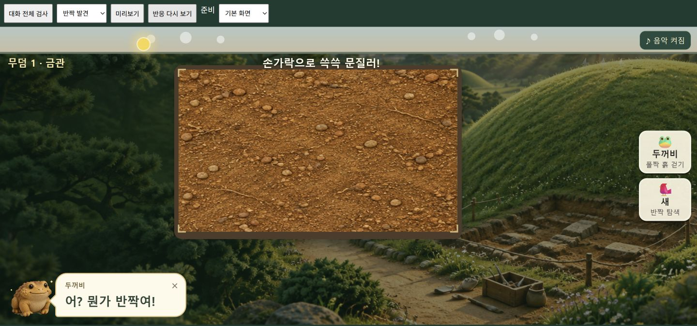

# 토우 중복 표시 수정 · 2026-10-22

## 원인과 변경

발굴 현장의 캔버스 토우와 말풍선의 DOM 토우가 동시에 그려졌다. 기억 팝업의 두꺼비도 같은 배경 토우와 겹쳤다. 화면 위치 조정으로는 합류한 토우 수·화면 크기에 따라 재발하는 문제였다.

현재 보이는 말풍선·기억·대화·합류·도감·무덤 안내·보스 화면을 기준으로 배경 토우 그리기를 건너뛴다. 매 프레임 가시성을 결정하므로 닫기·자동 종료·화면 이동 후 배경 토우가 복원된다. 유물·배경·입력·발굴판 크기는 바꾸지 않았다.

## 검증

- 수정 전 브라우저 계측에서 `tooHard` 말풍선 뒤의 배경 토우 그리기를 검출했다.
- 수정 후 실제 배경 캐릭터 그리기 호출을 계측하는 `checks/story-screen.html` 137개 통과. 11종 반응, 닫은 뒤 복원, 기억·합류 전환, 경고 중 발굴 입력을 포함한다.
- 네 토우가 모두 합류한 마지막 무덤에서 1440×900, 1024×768, 768×1024, 390×844, 844×390을 검사했다. 말풍선 화면 경계, 배경 토우 숨김/복원, 발굴판 크기 유지 확인.
- `npm test` 65/65, 금관 이야기·발굴 완료 회귀 검사 9/9 통과. 보호 대상 소스와 테스트는 변경하지 않았다.
- 데스크톱 반짝 발견과 모바일 생각구름을 실제 화면으로 확인했다.

