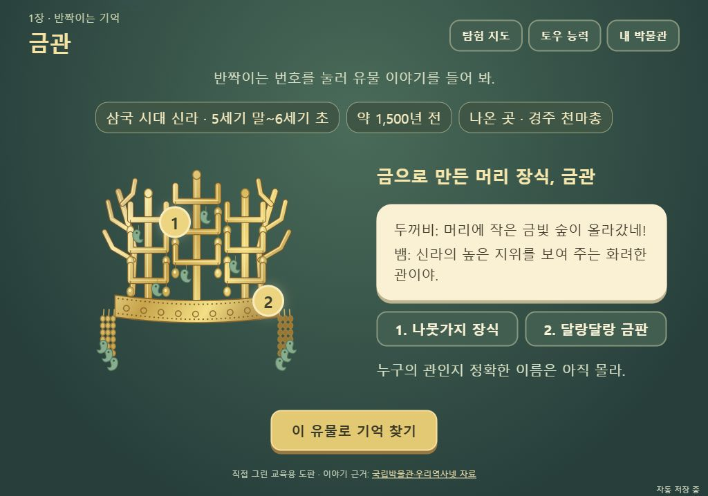
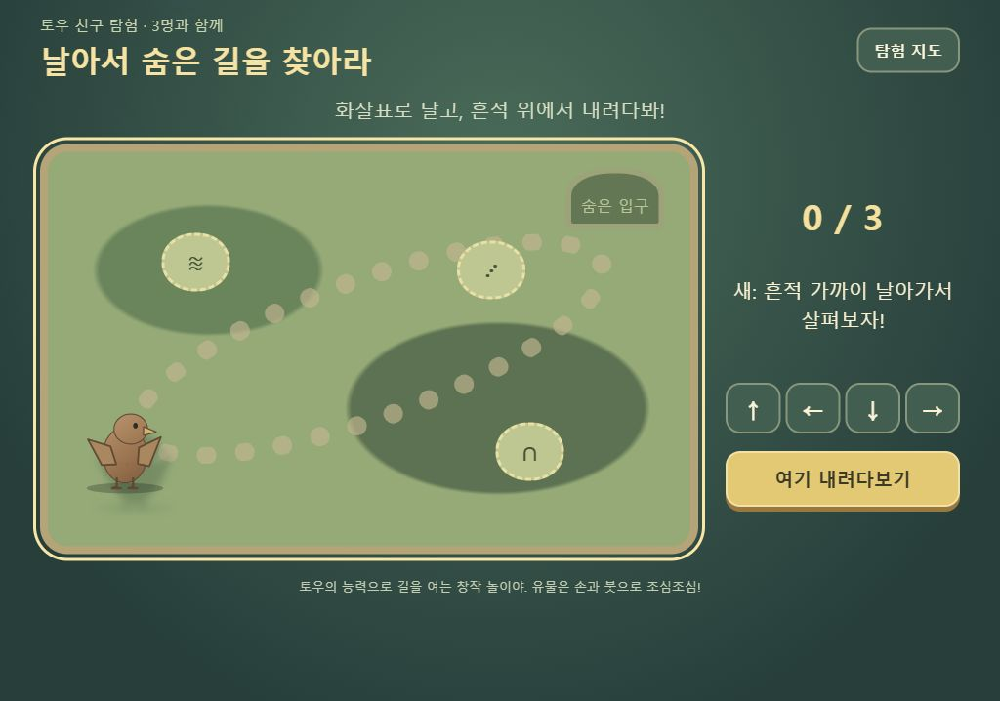

# 토우 획득과 능력 탐험 · 쉬운 유물 이야기

사용자가 승인한 방향은 ‘토우를 하나씩 얻으면 할 수 있는 행동이 늘어나는 보상’과 ‘유물의 시대·종류가 드러나는 쉬운 설명’이다.

## 구현 흐름

새 모험은 안내역 뱀과 시작한다. 입구에서 흙 조각을 걷고 두꺼비 토우를 깨우면 점프 능력을 얻는다. 착지점을 직접 정해 세 흙더미를 걷으면 금관 발굴 구역이 열린다. 금관의 기억을 찾으면 새 토우를 얻고, 지도를 실제로 날아다니며 가까운 흔적을 조사해 말다래 구역을 연다. 말다래 뒤에는 거북을 얻어 돌을 받치고 틈을 조사한다. 첫 전시 후에는 새로 두 번째 언덕의 경로를 조사한다.

단순한 보조 버튼과 구별하려고 능력을 독립된 조작 장면으로 구현했다. 두꺼비는 착지 조준과 점프, 새는 위치 이동과 근접 조사, 거북은 받칠 자리 선택과 틈 조사의 두 행동을 쓴다. 캐릭터 수집과 열린 경로는 저장된다. 길 열기 중 지도에 나가도 획득한 친구는 남고, 짧은 길 열기만 다시 시도한다. 기존 발굴 모델의 수치와 입력은 변경하지 않았다.

토우 능력은 창작 놀이이며 실제 유물에 뛰거나 충격을 주는 발굴법으로 설명하지 않는다. 실제 유물 발견 단계는 기존 손·붓 입력으로 마무리한다. 내부 저장 키 `frog`는 이전 데이터 호환을 위해 유지하지만 화면의 친구 이름과 점토 도판은 두꺼비로 통일했다.

## 유물 설명

발견 직후에 시대, 대략적인 시기, 출토 장소, 물건의 종류가 보인다. 유물 위 번호 두 곳을 누르면 두 문장 이내의 토우 대화가 바뀐다. 모든 설명을 클릭하거나 새 확인 문제를 풀어야 진행되는 구조는 아니다. 전시실에서도 선택한 유물의 이야기를 다시 볼 수 있다.

| 자료 | 소개 내용 | 근거 |
|---|---|---|
| 천마총 금관 | 삼국 시대 신라, 5세기 말~6세기 초, 경주 천마총, 금으로 만든 관. 가지 모양 장식과 달개·굽은 옥 | [국립경주박물관 소장 명품전](https://gyeongju.museum.go.kr/convert/preview/1614403482133/index.html), [국립중앙박물관 금관 설명](https://www.museum.go.kr/MUSEUM/contents/M0501000000.do?relicRecommendId=16890&schM=view) |
| 천마 그림 말다래 | 신라, 경주 천마총, 말의 안장 옆에서 진흙을 막던 물건. 천마 그림과 자작나무 껍질 | [국립경주박물관 전시품 설명](https://gyeongju.museum.go.kr/kor/html/sub02/0202.html?d_mng_no=193&mng_no=298&mode=V) |
| 천마총 유리잔 | 신라, 5세기 말~6세기 초, 경주 천마총. 유리 그릇과 교류의 흔적 | [국립경주박물관 소장 명품전](https://gyeongju.museum.go.kr/convert/preview/1614403482133/index.html) |
| 봉수형 유리병 | 신라 5세기 무덤인 황남대총 남분에서 발견. 새 머리 모양 주둥이와 금실로 고친 손잡이 | [국립중앙박물관 큐레이터 설명](https://www.museum.go.kr/MUSEUM/contents/M0501000000.do?relicRecommendId=519881&schM=view), [국립경주박물관 전시자료](https://gyeongju.museum.go.kr/_prog/download/index.php?d_type=1&file_realname=special2_0_20150805175025.pdf&filename=20170809141739_00ecpjip7yikf5s2ulitf82u2zrz41.pdf&func_gbn_cd=display_mgr&site_dvs_cd=kor) |
| 금제 허리띠 | 신라, 황남대총 북분, 여러 금판과 물고기 모양 등의 드리개 | [국립중앙박물관 큐레이터 설명](https://www.museum.go.kr/MUSEUM/contents/M0501000000.do?relicRecommendId=16890&schM=view) |
| 두 봉분 조사 그림 | 신라의 황남대총을 위에서 조사한 기록. 남쪽과 북쪽의 자료를 구별 | [국사편찬위원회 우리역사넷](https://contents.history.go.kr/mobile/kc/view.do?code=kc_age_10&levelId=kc_r100044) |

시기를 확정하기 어려운 항목에 제작 연도를 만들어 넣지 않았다. 특히 병의 시대 표시는 무덤에서 발견된 맥락이며 신라에서 만들었다는 뜻이 아니다. 토우의 농담은 창작이고, 유물 도판은 모두 직접 그렸다. 사진을 복제하거나 변형하지 않았다.

## 검증

보호된 기존 검사 33개, 모험 모델 9개, 이전 모듈 15개, 토우 모델 4개 통과. 독립 검토에서 시대·재료·장소 출처를 확인했고, 시작 전 두꺼비가 말하던 도입은 뱀의 안내와 잠든 실루엣으로 바꿨다. 시대·출토지 등 유물 설명 글씨는 가로 태블릿에서 20px로 맞췄다.

실제 브라우저 검사 중 창을 전환하면 비행이 느려지는 문제를 발견해 경과 시간으로 이동하도록 고쳤다. 둘째 지도에서는 시작 위치가 조사 범위 밖이 되도록 조정했다. 검사 도구도 고정 시간만 기다리던 방식을 바꾸어 점프·이동과 게임 초기화가 실제로 끝난 뒤 다음 입력을 보낸다. 재접속 검사 때는 새 iframe을 만든다.

최종 DPR 2 브라우저 전체 플레이에서 **123개 확인 항목 통과**. 토우 획득·네 경로·금관 중간 발굴 복원·여섯 자료의 시대와 출토지·관찰 대화·두 무덤의 전시·결말·재접속·재발굴을 확인했다. 재발굴 전후 저장 문자열도 같았다. 원본 결과는 [companion-browser-results.json](companion-browser-results.json)에 있다.

1024×768 화면에서 유물 정보와 조작 버튼을 확인했다. 390×844에서는 유물 소개가 세로로 이어지고 가로 넘침이 없었다. 능력 메뉴에서 점프를 다시 열어 점프 중 지도에 나가도 정상 복귀했다. 보호 대상 파일과 기존 테스트는 변경하지 않았다.

