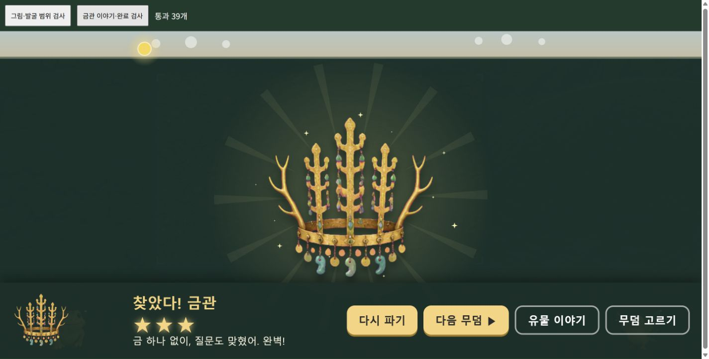

# 금관이 다 보이는데 발굴이 끝나지 않는 문제 (2026-10-21)

기준 커밋: `1ee9280`의 발굴 도전판. 시간 제한을 제거한 최근 흐름과 이야기·합류를 유지했다.

금관 완료 판정은 가로 6칸 × 세로 1칸인데, 렌더러는 6칸 × 3칸 크기의 상자에 금관을 비율 유지로 그렸다. 실제 그림이 가운데에 몰리고 판정 밖 위아래로 넘어갔다. 그림을 모두 드러내도 그림이 없는 양 끝의 필수 칸이 남았고, 완료에 연결된 3·4번째 기억 조각도 열리지 않았다.

- 금관 배치를 3칸 × 2칸으로 맞췄다. 필수 칸 수는 6개 그대로다.
- 금관만 별도 확대하던 코드를 없애 모든 유물을 실제 발굴 칸의 경계 안에 그린다.
- 절반 이상 찾으면 기존 안내 줄에 진행 개수와 남은 곳을 표시하고, 남은 칸에 반짝임을 준다.
- 화면 크기·여백·붓질 수치·보호 대상 모듈·기존 테스트는 수정하지 않았다.

검증:

- 수정 전 `checks/crown-completion.html`의 실제 렌더러 검사에서 금관 그림이 판정 영역을 벗어나는 실패를 재현했다.
- 수정 후 5개 유물 × 3개 배치에서 그림 경계와 모든 필수 칸의 불투명 픽셀 겹침: 30개 통과.
- 별도 메모리 저장소에서 실제 PointerEvent로 흙·나무를 걷어 이야기 1→2→발견→3→4→거북 합류→완료→다음 무덤 해금: 9개 통과.
- `npm test`: 기존 65개 통과. 브라우저 콘솔 오류 없음.

프로젝트 루트를 정적 서버로 열고 `/checks/crown-completion.html`에서 두 검사 버튼을 차례로 누르면 재검증할 수 있다. 실제 사용자 별 기록은 쓰지 않는다.

