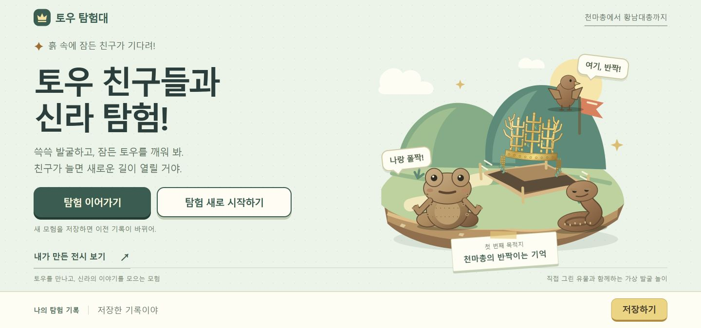
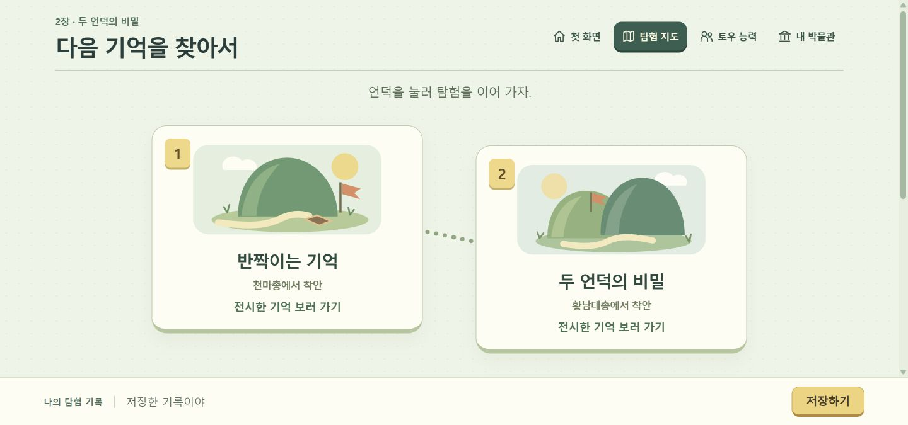
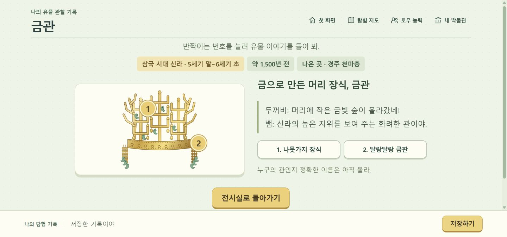
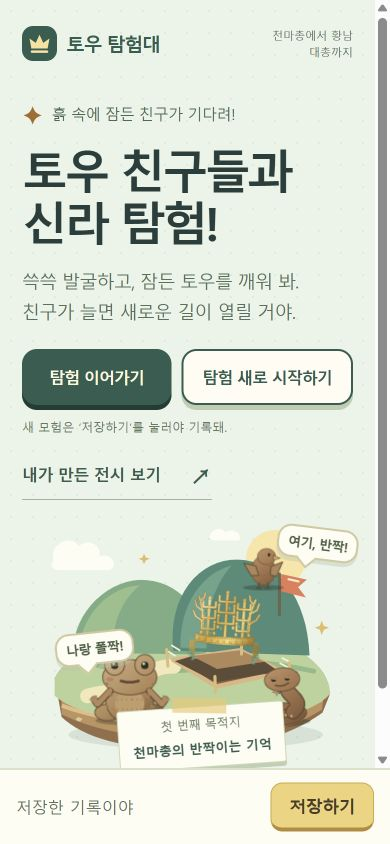

# 탐험 시작 선택과 UI 재구성

2026-10-20. 사용자가 요청한 새 시작 버튼과 전반적인 UI 재설계를 반영했다.

## 시작과 저장

첫 화면에서 이어가기와 새로 시작하기를 나란히 선택한다. 새로 시작하면 모험 데이터, 발굴 상태, 토우 장면, 이전 이야기 화면의 선택과 타이머를 초기화하고 첫 도입으로 이동한다. 기존 저장은 변경하지 않는다. 저장 버튼을 눌렀을 때만 새 모험이 기존 기록을 바꾸며, 첫 화면에 이 동작을 명시했다.

## 화면

밝은 청록색 바탕, 짙은 잉크색 제목, 종이색 관찰 영역, 금색 주요 행동을 사용했다. 첫 화면에는 직접 그린 봉분·발굴터 그림과 토우 Canvas를 합쳤다. 지도는 두 장소를 경로로 연결하고, 토우 메뉴는 각 능력과 해금 상태를 담은 수집 화면으로 만들었다. 유물 소개는 큰 도판과 짧은 이야기를 나란히 둔다. 전시·능력·발굴 안내·저장 영역에도 같은 버튼과 색 체계를 적용했다.

첫 화면으로 돌아가는 내비게이션을 이야기 화면마다 추가했다. 휴대폰에서는 메뉴를 네 칸으로 배치하고, 두 시작 버튼은 한 줄을 유지한다. 세로 스크롤과 고정 저장 영역을 나눠 내용이 가려지지 않게 했다.

새 그림 `expedition-island.svg`, `tomb-map-1.svg`, `tomb-map-2.svg`와 메뉴 아이콘은 직접 제작했다. 외부 이미지·폰트·패키지는 추가하지 않았다.

## 확인

- 보호된 기존 검사 33개를 포함한 Node 검사 61개 통과.
- 새 모험 시작·이전 유물이 있는 저장 보존·명시적 저장·발굴/친구 복원 브라우저 검사 **20개 통과**.
- 새 디자인으로 두 무덤·전시·결말·저장 복원·재발굴 전체 검사 **123개 통과**.
- 390×844 첫 화면에서 두 버튼의 위쪽 위치가 같고, 각 높이가 56px임을 확인. 유물 설명도 가로 넘침 없이 표시됨.
- 보호 대상 모듈과 `prototype/tests/`는 변경하지 않음.

브라우저 원본 결과: [redesign-check-results.json](redesign-check-results.json). 낮은 데스크톱 화면에서도 유물 설명의 다음 버튼이 저장 영역 위에 보이는지 확인했다.

