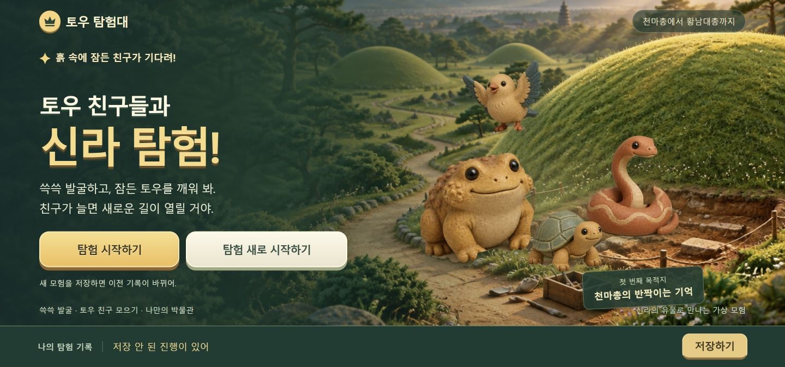
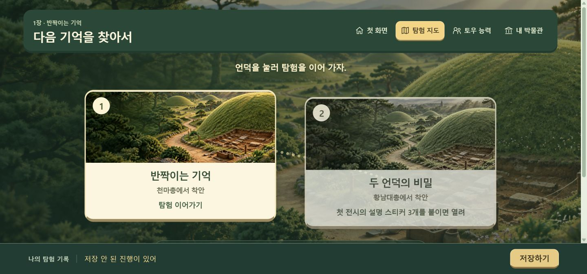
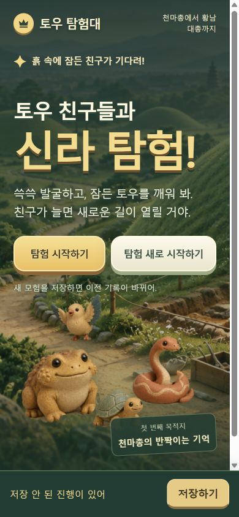
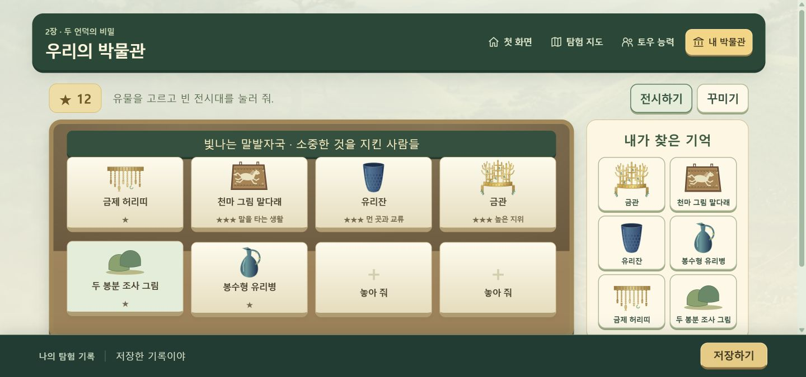
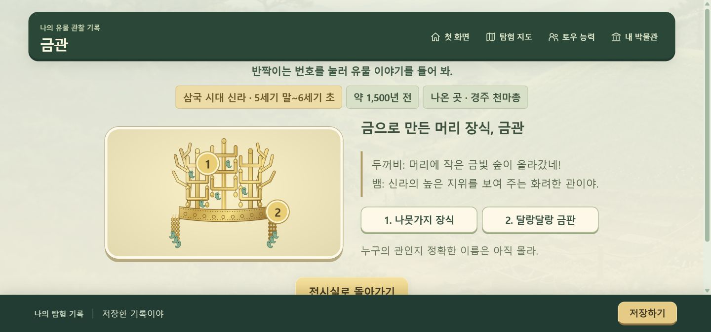

# 토우 탐험대 — 점토 디오라마 디자인

사용자 요청: 힉스필드로 디자인을 다시 만들되 크레딧은 최소한 사용한다.

## 방향

첫 화면 전체가 햇살 드는 신라 봉분 풍경이다. 왼쪽은 큰 제목과 두 시작 버튼,
오른쪽은 손으로 빚은 듯한 토우 친구들이 차지한다. 웹사이트 소개 화면이 아니라
게임의 시작 장면으로 구성한다. 지도와 능력 놀이도 같은 풍경과 캐릭터를 재사용한다.

- 색: 숲 #163d35, 옥빛 #2f7460, 햇살 #ffd47a, 점토 #ac7147, 종이 #fff6df.
- 글자: 맑은 고딕/Apple SD Gothic Neo. 큰 제목은 두꺼운 획과 짙은 그림자,
  설명은 짧은 문장과 높은 대비. 본문은 20px 전후.
- 구조: 첫 화면과 지도는 풍경 중심, 관찰·전시 화면은 밝은 작업대 중심.
- 장식: 실제 누를 수 있는 버튼에만 두께를 준다. 점무늬 배경과 장식용 배지는 줄인다.
- 캐릭터: 네 토우를 하나의 투명 아틀라스로 생성해 모든 캔버스에서 공통으로 사용한다.
  반응은 코드의 이동·회전·별 효과로 구현하며 추가 유료 애니메이션을 생성하지 않는다.
- 유물: 기존 교육용 직접 그린 도판을 유지한다. 생성 그림을 역사적 유물 사진으로 제시하지 않는다.

## 비용 및 범위

사전 견적: Z Image 배경 1장 0.15 + GPT Image 2.5 토우 아틀라스 1장 0.25 = 0.40크레딧.
Z Image 요청은 최종 실패했으며 잔액에서 비용이 빠지지 않았다. 배경을 GPT Image 2.5
0.25크레딧으로 대체하여 실제 사용은 **0.50크레딧**, 잔액은 **69.86 → 69.36**이다.
성공 이미지 두 장 외에 영상·음성·업스케일·유료 배경 제거는 요청하지 않았다.
새로운 호스팅·멀티플레이 서버를 만들지 않고 기존 정적 게임에 적용.
AI 이미지 사용은 이번 사용자의 힉스필드 제작 요청에 따른 범위 변경이며,
기존 유물 도판과 보호 대상 로직·테스트는 수정하지 않는다.

수동 저장, 이어하기/새로 시작하기, 두 무덤 이야기, 토우 능력 탐험은 유지한다.

## 구현 및 확인

- 전체 화면 배경, 네 토우, 지도, 능력 놀이, 유물 관찰, 박물관, 저장 표시를 같은 색·재질로 정리.
- 생성된 토우는 요청과 달리 불투명 배경이었다. `clay-art.js`에서 손으로 딴 윤곽으로
  한 번만 캔버스에 잘라 캐시한다. 이미지 재생성 비용 없이 네 캐릭터를 분리했다.
- 두 이미지 총 약 3.43MB. 외부 이미지 주소 대신 저장소의 상대 경로로 불러온다.
- 캐릭터 반응: 조심하라는 기울임, 돌 무너짐의 움찔, 단서 반짝임, 발견의 폴짝.
- 기존 33개와 추가 모델 28개, 총 61개 Node 검사 통과.
- 수동 저장·새로 시작 브라우저 검사 20개 통과.
- DPR 2 두 무덤 전체 플레이·전시·결말·재발굴 브라우저 검사 123개 통과.
- 1440px와 390px에서 시작 버튼 두 개가 같은 줄이며 가로 넘침 없음.
- 기존 실제 저장은 덮어쓰지 않고 별도 메모리 저장을 쓰는 검사 페이지에서 검증.
- 검사 상세: [clay-check-results.json](clay-check-results.json).

