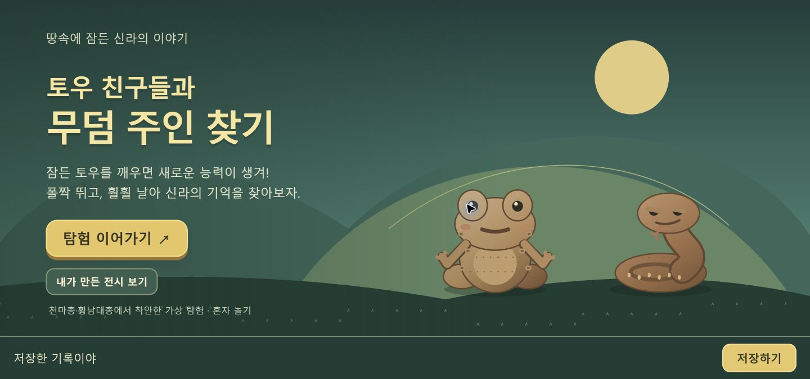

# 저장 버튼으로만 진행 저장

2026-10-20 사용자 요청에 따라 자동 저장을 제거했다. 기존 저장 기록은 읽지만 발굴, 친구 획득, 전시 변경, 화면 이탈은 저장소를 쓰지 않는다. 화면 아래 ‘저장하기’ 버튼을 눌렀을 때만 현재 모험과 발굴 상태를 기록한다.

마지막 저장과 달라진 진행은 ‘저장 안 된 진행이 있어’, 저장 성공은 ‘여기까지 저장했어!’로 표시한다. 실패 시 이전 기록을 유지하고 다시 누르도록 알린다. 저장하지 않고 새로고침하면 마지막 저장 상태로 돌아간다. 다시 파기의 임시 진행과 짧은 능력 놀이 도중 위치는 저장 범위에 포함하지 않는다.

검증: 보호 검사 33개를 포함한 Node 검사 61개 통과. 메모리 저장소를 사용한 브라우저 전용 검사 15개에서 자동 쓰기 없음, 명시적 저장, 미저장 발굴 취소, 저장한 발굴·친구 복원, 실패 시 이전 기록 보존을 확인했다. [검사 결과](manual-save-results.json). 전체 모험 검사도 저장할 때 실제 버튼을 누르도록 바꿔 두 무덤·결말·저장 복원·재발굴 123개 항목을 통과했다. 보호 대상 파일과 기존 테스트는 수정하지 않았다.

저장 영역은 게임 화면과 공간을 나누어 배치했다. 390px 너비에서 가로 넘침 없이 버튼 높이 51px을 확인했다.

