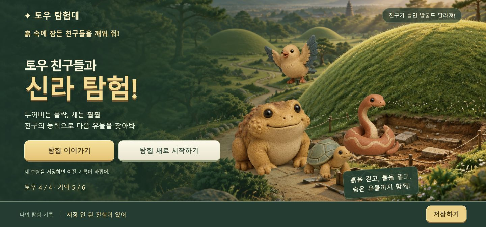
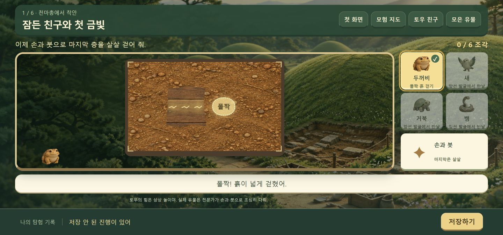
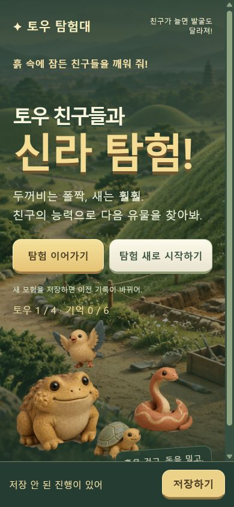

# 토우 획득 → 능력 발굴 → 다음 구역

2026-10-20 사용자 후속 요청. 이전 별도 능력 미니게임과 전시 해금 중심 진행을 폐기한다.

## 새 핵심 흐름

1. 두꺼비 깨우기 → 착지점을 눌러 넓은 흙을 걷기 → 금관 발굴 → 새 획득.
2. 새로 흔적을 찾아 발굴 위치 확인 → 두꺼비로 흙 걷기 → 말다래 발굴 → 거북 획득.
3. 두꺼비 흙 걷기 + 거북 돌 밀기 → 유리잔 발굴 → 뱀의 틈 탐색 능력 획득.
4. 두 번째 무덤으로 바로 이동. 뱀으로 좁은 틈을 열어 봉수형 유리병 발굴.
5. 네 친구를 조합해 금제 허리띠 발굴.
6. 새와 두 봉분을 조사해 기억 지도를 완성. 열린 구역 재발굴과 연습 도전을 제공.

전시는 선택 활동이다. 전시대/설명 스티커/별이 모험 진행을 막지 않는다.
유물 설명은 발견 순간 시대·출토지·특징을 짧게 보여 주고, 자세한 관찰은 언제든 다시 연다.
토우 기술은 실제 발굴 상태를 바꾼다. 능력 버튼만 누르고 끝나는 별도 미니게임을 두지 않는다.
마지막 얇은 층은 직접 살살 붓질하며 유물 조심히 다루기를 남긴다.

## 구현 제약

보호 대상 dig-model/grid/input/dialogue/hud 및 prototype/tests는 변경하지 않는다.
새 진행 모델과 UI를 별도 모듈로 만들고 기존 발굴 함수로 능력을 적용한다.
수동 저장만 허용. 이전 저장은 읽어서 옮기되 자동 저장/삭제하지 않는다.
진행 도중 새 게임을 시작해도 저장하기를 누르기 전까지 기존 기록은 유지한다.

## 그림

첫 작업 0.50크레딧에 이어 재질 아틀라스·유물 아틀라스·두 번째 무덤 배경 각 0.25,
추가 상한 0.75크레딧. 생성 그림은 교육용 창작 삽화이며 실측 복원도가 아니다.
크레딧을 쓰는 런타임 기능은 없다.

실제 잔액: 69.36 → 68.61. 이번 추가 0.75, 전체 1.25크레딧.

## 검증

- 보호 대상 검사 33개 및 새 순수 모델 검사 6개 통과.
- 새 브라우저 흐름 검사 63개 통과: 친구 순차 획득, 실제 층 변경,
  마지막 붓질, 전시 없이 다음 구역 이동, 두 봉분 근접 조사, 마지막 기억 지도,
  수동 저장, 저장 실패, 중간 발굴 복원, 저장하지 않은 새 시작 취소, 선택 전시.
- 구버전 저장을 읽어 옮기되 원본 키는 삭제/수정하지 않는다.
- 기본 진입 파일은 `prototype/index.html`, 별도 `quest.html`도 같은 진입을 제공한다.
- 최종 배치로 전체 검사 63개를 다시 통과했다. 결과: [quest-check-results.json](quest-check-results.json).
- 390×844 화면에서 두 시작 버튼의 상단 좌표가 동일하고 너비 넘침이 없다.

## 화면

가로 화면에서는 발굴판과 다섯 도구를 나란히 배치한다. 능력을 쓸 자리에는
‘폴짝/밀기/틈’ 표시를 주며, 직접 다른 지점을 눌러 능력을 사용하는 것도 가능하다.
획득하지 않은 토우는 도구에서 잠기고 발굴 장면에 등장하지 않는다.
