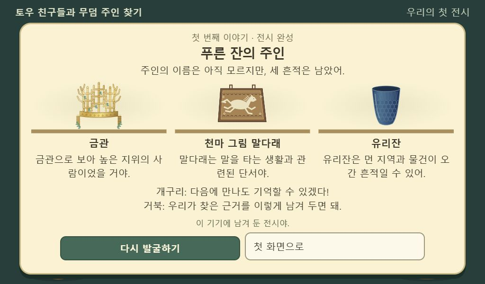

# 첫 무덤 이야기 확장

후속 수정: 전시 전 근거 연결과 새 사례 판단을 추가했다. 현재 학습 흐름과 검증은 [학습 흐름 검토](learning.md)를 함께 읽는다. 아래 36개 검사 결과는 첫 이야기 확장 당시의 기록이다.

사용자 피드백: “금관 발견 말고 뭐 없어? 뒤에 스토리가 뭐 이어져야지.”

금관을 찾으면 끝나던 0차 손맛 시제품을, 세 유물의 흔적으로 주인의 삶을 짐작하고 첫 전시를 만드는 한 편의 이야기로 확장했다. 기존 비주얼 인수인계의 `found → again` 제한은 이 후속 요청으로 대체한다.

## 플레이 흐름

1. 기억을 잃은 개구리와 뱀이 주인의 흔적을 부탁한다.
2. 기존 흙·돌·나무 발굴로 금관을 찾으면 거북 토우가 합류한다.
3. 두 특징을 관찰하고, 금관에서 높은 지위를 짐작한다.
4. 같은 무덤의 나무 바닥에서 천마 그림 말다래를 찾아 말을 타는 생활과 연결한다.
5. 푸른 유리잔을 찾아 먼 지역과의 교류를 짐작한다.
6. 세 단서를 모으되 실제 이름은 아직 모른다고 구분한다.
7. 아이가 별명을 고르고 세 유물의 전시를 완성한다. 이 기기에 저장되며 첫 화면에서 다시 볼 수 있다.

두 번째·세 번째 구역은 이미 내려온 나무 바닥에서 시작한다. 발굴 수치나 입력 모듈은 변경하지 않고 새 구역의 초기 상태만 구성한다. 오답은 감점 없이 다시 선택할 수 있다. 가상 토우의 기억과 유물에 근거한 추론을 구분한다. 다음 무덤, 교사용 서버, 자유 입력, 학급 기능은 구현하지 않았다.

## 고증과 도판

- [국립경주박물관 — 천마그림 말다래Ⅰ](https://gyeongju.museum.go.kr/kor/html/sub02/0202.html?d_mng_no=193&mng_no=298&mode=V): 자작나무 껍질 바탕과 달리는 동물 그림, 장식 띠를 참고했다. 벽화가 아닌 안장 부속품으로 설명하고 발견 후 원본 보존·복제 도판 관찰을 안내한다.
- [한국민족문화대백과사전 — 천마총유리잔](https://encykorea.aks.ac.kr/Article/E0041387): 남색 유리, 윗부분의 세로 무늬와 아래쪽 거북등무늬를 그렸다. 먼 지역과의 교류 가능성까지만 추론하며 정확한 제작국이나 주인의 직접 여행을 단정하지 않는다.
- [국사편찬위원회 우리역사넷 — 천마총](https://contents.history.go.kr/front/tg/view.do?levelId=tg_001_0240): 지위가 높은 인물의 무덤이라는 맥락을 사용한다. 특정 왕의 이름·성별은 정답으로 제시하지 않는다.

사진이나 외부 이미지 파일을 사용하지 않았다. 금관·말다래·유리잔·거북은 Canvas로 직접 그린 교육용 도판/창작 캐릭터이며 정밀 복원도라고 주장하지 않는다. 발굴 위치와 세 유물의 순서는 놀이를 위한 구성이다.

## 검증 방법

- `npm test`: 기존 33개. 보호된 5개 모듈과 기존 테스트는 수정하지 않았다.
- `npm run test:story`: 관찰·추론 조건, 오답 재시도, 순서, 별명, 저장값 검증·저장 거부 등 8개.
- 로컬 서버 루트에서 `tools/story-check.html`: DPR 2 입력으로 세 발굴을 수행하고 전시·재시작·새로고침 후 복원까지 검사. 검사 전 저장값은 검사 종료 시 복원한다.
- 기존 `tools/visual-check.html`은 최신 통합 검사로 안내한다. 이전 시각 검증 기록은 당시 커밋의 증거로 유지한다.
- 독립 코드 검토에서 진행·저장·렌더링을 막는 회귀는 발견되지 않았다.

공개 Pages 병합·배포는 별도다. 로컬 검증 결과와 화면은 이 문서 옆에 기록한다.

## 실행 결과

2026-10-19: 기존 33개 및 이야기 8개 테스트 통과. 브라우저의 36개 확인을 기본 화면과 1024×600 게임 영역/DPR 2에서 통과했다. 브라우저 error/warn 기록 없음. 전시 화면은 작은 가로 화면에서 설명과 두 버튼까지 스크롤 없이 표시됨을 확인했다. 실기기 FPS나 어린이의 이해도 검증을 뜻하지 않는다.

- [브라우저 확인 결과](story-check.json)
- 완성 전시 화면:

