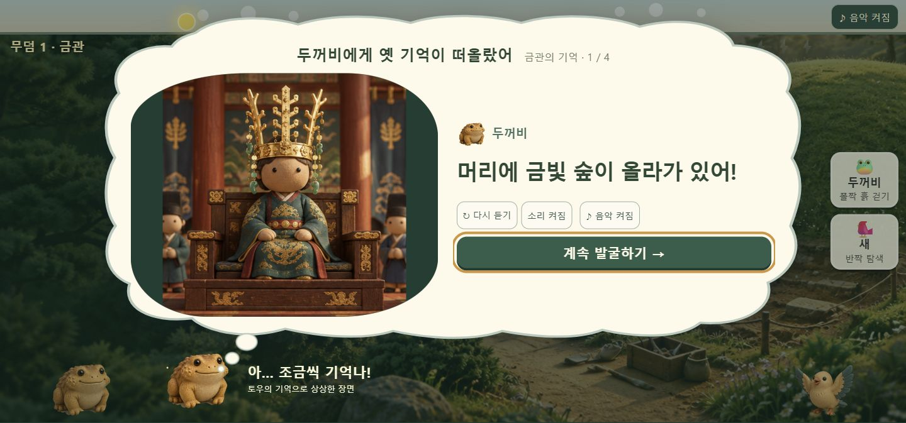

# 발굴 말풍선·기억 생각구름 (2026-10-22)

- 짧은 경고와 능력 반응 11종은 발굴 현장 왼쪽 아래 말풍선으로 표시한다. 조작을 막지 않으며 5~7초 뒤 사라진다. 경고는 직접 그린 당황한 두꺼비 SVG를 사용한다.
- 유물 기억과 연결 질문은 두꺼비 머리 위 생각구름 안에 표시한다. 발굴 현장을 배경으로 남기고, 기억이라는 안내와 상상한 장면이라는 표시를 넣었다. 기존 그림·음성·선택지는 유지했다.
- 새 그림은 직접 작성한 SVG 두 장이며 유료 생성 비용은 없다. 발굴판 크기·타이머·음악·저장 방식은 변경하지 않았다.
- 검증: npm test 65/65, checks/story-screen.html 44/44, checks/crown-completion.html 9/9. 경고 중 실제 포인터 발굴, 기억 중 입력 차단, 네 장면 이후 완료·토우 합류를 확인했다.
- 실제 브라우저에서 기본 화면 및 390×844·844×390 테스트 프레임을 확인했다. 작은 가로 화면은 대사 영역에서 스크롤 가능하다.
- 보호 대상 소스와 prototype/tests는 수정하지 않았다.

